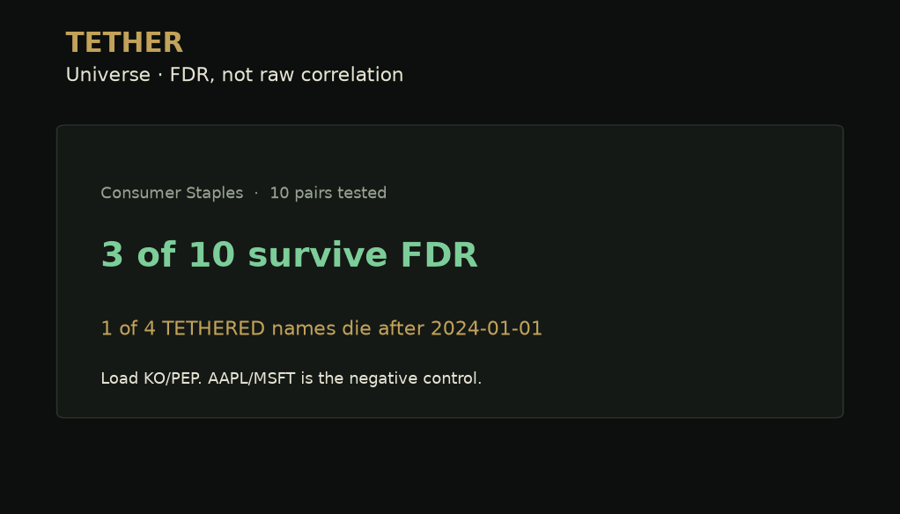

# TETHER

[](https://github.com/atharva-gite/pairstrading/actions/workflows/ci.yml)

Market-neutral pairs desk. You do not trade two stocks — you trade whether their **tether is still holding**.

[](docs/assets/tether.gif)

*Universe (FDR) → walk-forward IS vs OOS → AAPL/MSFT as the negative control → borrow and net book β → Research grounded in the blotter.*

**Live Demo:** [Pair Trading Streamlit App](https://atharva-gite-pairstrading.streamlit.app/). **Research note (PDF):** [KO/PEP vs AAPL/MSFT: when correlation is not a book](docs/ko-pep-vs-aapl-msft.pdf) · [markdown](docs/ko-pep-vs-aapl-msft.md)

## Why this is not another z-score notebook

| What most repos do | What TETHER does |
|---|---|
| Screen and backtest on the same sample | **Walk-forward:** discover hedge and tether through 2023, trade 2024+ with frozen rules |
| Raw p < 0.05 on every pair | **Benjamini–Hochberg FDR** and Bonferroni on the sector scan |
| “AAPL/MSFT looks correlated” | Desk labels it **BROKEN** when half-life is ~114 days |
| Leg beta vs SPY | **Net market β of the dollar book** as Kalman/rolling β drifts |
| Zero borrow | Toggle **stock-borrow** on short notional |
| Chatbot with vibes | Groq briefing + Research chat **grounded in the book JSON** |

If out-of-sample Sharpe is worse than discovery, **that number stays on the Desk**. Interviewers hunt for look-ahead. This is how you show you know.

## 40-second path

1. **Universe** — Consumer Staples. Scan sector. Read *N of K pairs survive FDR*. Load **KO/PEP**.
2. **Desk** — Walk-forward table (IS Sharpe vs OOS Sharpe). If OOS lost, leave it. Check net β and borrow.
3. **Research** — Ask *why is this BROKEN?* (try AAPL/MSFT). The model only sees this ticket’s blotter, p-values, and split.

Default window is **2019-01-01 → today**, split **2024-01-01**.

## Run locally

```bash
python3 -m venv .venv
source .venv/bin/activate
python3 -m pip install -r requirements.txt
streamlit run app.py
```

Copy `.env.example` to `.env` and set `GROQ_API_KEY` for desk briefings and Research. Never commit `.env`.

## Develop

```bash
python3 -m pip install -r requirements-dev.txt
ruff check . && ruff format --check .
pytest --cov
```

CI runs the same lint and tests on Python 3.12 and 3.14 for every push and pull request. Tests are offline (synthetic prices, a checked-in KO/PEP/AAPL/MSFT/SPY fixture, mocked Groq), and the build fails if coverage of `src/` drops below the floor in `pyproject.toml`.

`tests/test_regression.py` pins the walk-forward numbers for KO/PEP and AAPL/MSFT. If a model change moves them on purpose, run `python3 scripts/refresh_fixture.py` and review the JSON diff in the pull request.

Weekly jobs: Dependabot updates, `pip-audit` on the pinned requirements, and a live Yahoo Finance smoke test (`pytest -m live`).

Rebuild the GIF and PDF:

```bash
python3 scripts/make_demo_assets.py
```

## Layout

- `app.py` — RelVal desk: Universe, Desk, Tape, Research
- `src/stats.py` — Engle–Granger, Kalman/rolling OLS hedge, half-life, tether score, FDR sector screen
- `src/book.py` — signals, dollar sizing with per-leg cap, blotter, performance
- `src/engine.py` — walk-forward `PairsTradingEngine`, borrow, net β, cost sensitivity
- `src/llm.py` — Groq desk briefing and Research chat grounded in the book JSON
- `src/logic.py` — public API re-exporting the above
- `docs/ko-pep-vs-aapl-msft.pdf` — 2–3 page note for recruiters
- `docs/assets/tether.gif` — 20s walkthrough
- `tests/` — unit tests, frozen real-price regression, book limits, Groq mocks, app smoke test

## Notes

- Spreads and returns are in **log prices**.
- Hedge methods: Static OLS (frozen in walk-forward), Rolling OLS, Kalman Filter.
- Hedge-ratio sizing: `|A| + |β|×|A| = capital`. Equal-dollar puts the same notional on each leg.
- Costs: 10 bps slippage + 5 bps commission on traded notional, plus optional annualized borrow on shorts. The Desk reruns the book at 0 / 5 / 15 bps slippage.
- Limits: gross capital up to $10M per ticket; each leg capped at 75% of gross by default, scaling both legs so β holds.
- A pair with half-life above 60 days can be WEAK at best, never TETHERED.
