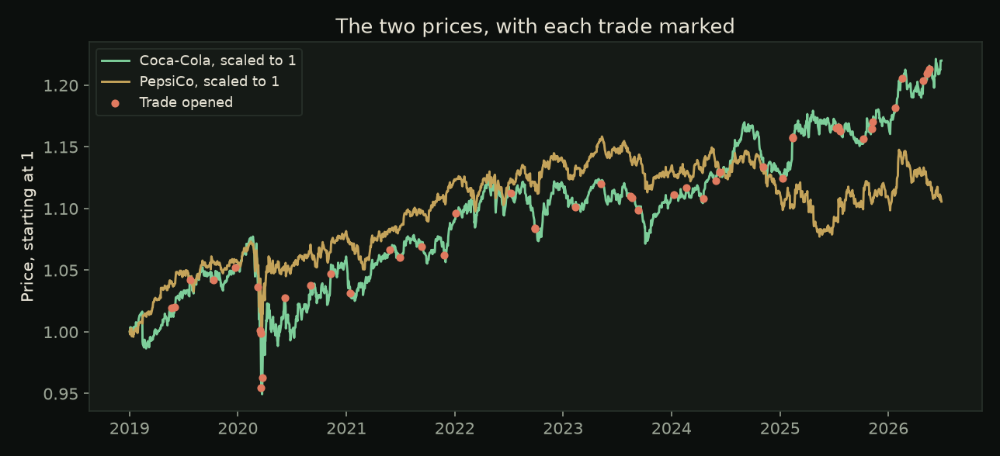
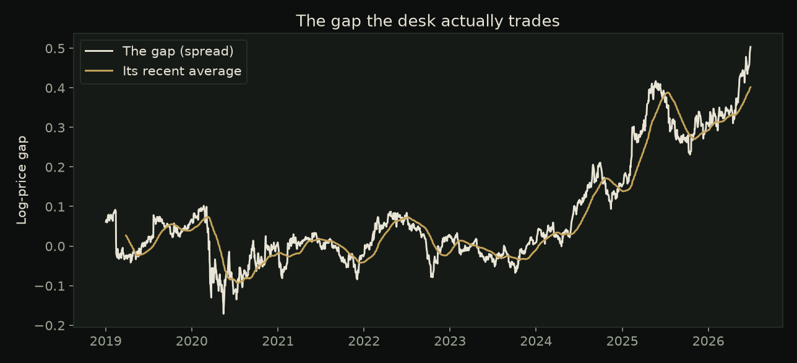
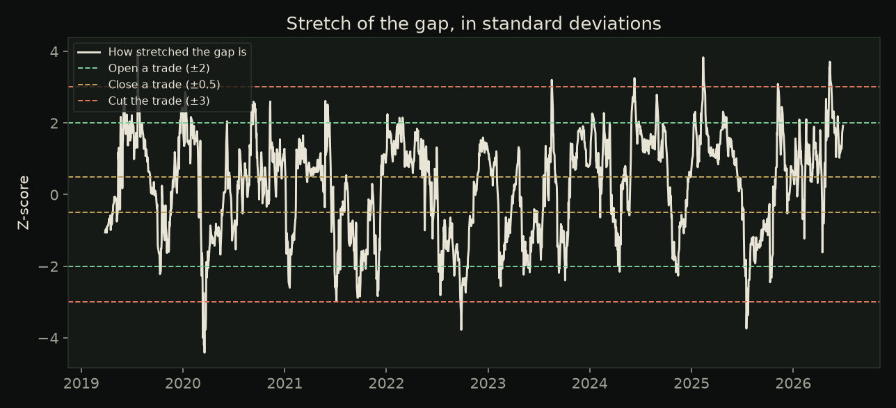
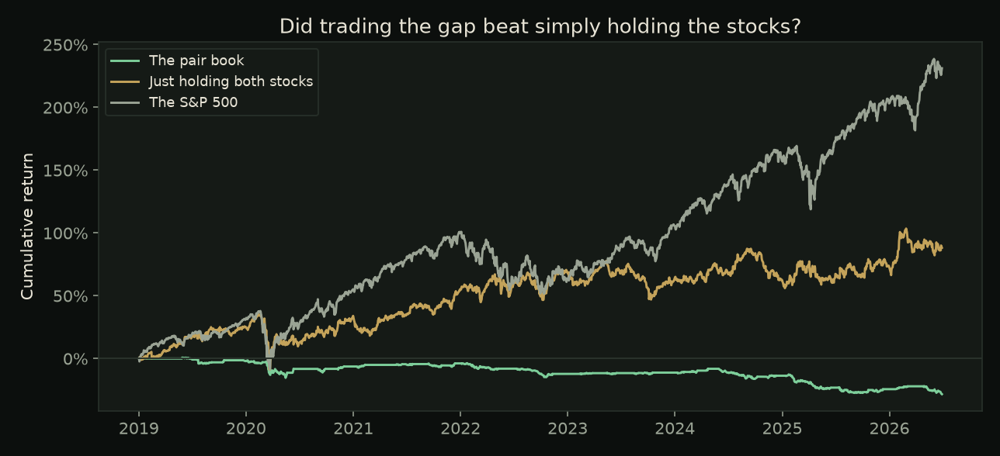

# How TETHER works

A short tour for someone who has never traded a pair. The pictures are a real Coca-Cola / PepsiCo run from the app.

## What the app is doing

Most investing apps ask whether a stock will go up. TETHER watches the **gap** between two stocks that tend to stay near each other, such as Coca-Cola and PepsiCo. When the gap gets unusually wide, the book buys the cheap one and shorts the expensive one, and waits for the gap to close.

Because one position profits when its stock rises and the other profits when its stock falls, a rising or falling market should mostly cancel out. That is what market-neutral means here.

The difficult part is knowing the two prices are still tied together. A link that used to exist can break. TETHER's job is to test that link and to refuse the trade when the test fails.

## The four screens

**Universe** searches a sector and ranks every pair. A high score means the prices still look tied together after a correction, called FDR, for the fact that many pairs were tested at once.

**Desk** is the verdict for one pair: whether the link is healthy, how much money the book made or lost, and whether that result survived a walk-forward test. The app learns the relationship on older data, freezes the rules, and only then trades the later data. A worse later result stays on screen.

**Tape** is the charts: the two prices, the gap, how stretched the gap is, and the profit chart. Each chart is explained below.

**Research** answers questions about the book you just ran. The model may use only that book's numbers. The **AI Report** on Universe and Tape is the same constraint, written as a formal paragraph.

## The charts

Both lines start at 1 so the gap is easier to see than raw dollar prices. Coral dots are days a trade opened. A trade is never "buy Coca-Cola." It is buy one name and short the other.

The white line is the gap, after a hedge ratio has scaled the two prices so they are comparable. The gold line is the gap's recent average. Trades open when the white line wanders far from the gold line, and close when it comes back.

A z-score measures how unusual today's gap is. The green dashed lines (±2) open a trade. The gold lines (±0.5) close it once the gap is nearly normal. The coral lines (±3) cut the trade at a loss, because a gap that keeps widening may mean the relationship broke. That loss is supposed to be visible.

Green is the pair book. Gold is simply holding both stocks. Grey is the S&P 500. A pairs book does not have to beat a rising market. It has to make its money from the gap. On this Coca-Cola / PepsiCo example the book lost money, and the chart shows that.

## Words on the desk

**Tether score (0–100).** How convincing the link is. **TETHERED** means tradable, **WEAK** means fraying, **BROKEN** means do not trade it as a pair. Apple / Microsoft is the built-in BROKEN example: the stocks rise together, and they are not a tradable pair.

**Cointegration.** The test for a long-run level the two prices return to. Two stocks can be highly correlated without being cointegrated. Correlation is not the trade.

**Half-life.** Days the gap typically takes to close halfway. Longer than about 60 trading days and the pair is not treated as tradable.

**Sharpe ratio.** Profit divided by how bumpy the path was.

**Drawdown.** The worst peak-to-trough loss.

**Net beta.** How much the book still moves with the market. Near zero is the goal.

**Costs.** Trades are charged commission, slippage, and sometimes a borrow fee on shorts. The Desk reruns the same trades at higher costs.

## The AI

The AI Report, the desk briefing, and Research receive a packet of numbers and are instructed to use nothing else. With no API key, the Report falls back to a paragraph built from those numbers by fixed rules, and it says so.

Keys are listed in `.env.example`: Groq, Google Gemini, Cerebras, Mistral, OpenRouter, and GitHub Models.

This is a research tool, not investment advice.
